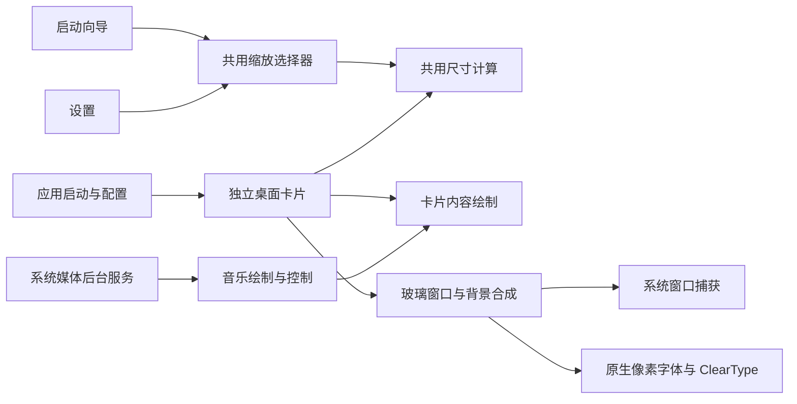

# macdowsOS Widget

仿macOS样式的桌面小组件

# 简介

基于Qt的仿macOS样式的第三方桌面小组件

支持电量、天气、时钟、词典和音乐组件。在托盘或组件右键菜单中打开小组件库，拖动卡片到桌面添加。

音乐组件直接读取 Windows 系统媒体会话，可显示曲目、艺术家、封面、播放状态与进度，并提供上一首、播放/暂停、下一首按钮。播放器必须向 Windows 发布媒体会话；未提供的封面、进度或控制能力会按实际情况显示。支持 Windows 10 1809 及以上版本。

启动向导和设置共用 40%–200% 连续缩放滑块。屏幕左下角的浮动卡片使用与桌面相同的逻辑尺寸；拖动时平滑预览，停止后按最终设备像素重新绘制。向导的操作区域保持固定大小，避免拖动时重建整个玻璃窗口。

字体支持 ClearType RGB 子像素渲染，新配置默认启用。已有配置保留原选项，可在设置中的“字体抗锯齿”切换。玻璃背景画质与字体分辨率独立，降低背景渲染比例不会降低字体像素密度；透明预览图像使用原生像素灰阶渲染。

桌面组件、右键菜单、启动向导和图库共用 `liquidglassstyle.h` 中的固定液态玻璃材质，统一折射、模糊与边缘反光。取消额外的暗色遮罩、整面着色和独立高光描边；音乐封面、按钮选中状态和内容分隔线继续承担内容与交互提示。设置不再提供“模糊程度”“透明度”，旧配置中的这两项会自动清理，显示大小、背景采样、画质和字体选项继续保留。

# 代码结构

| 目录或文件 | 职责 |
| --- | --- |
| `src/app` | 启动、配置管理、统一字体注册与抗锯齿策略 |
| `src/widgets/desktopwidget.cpp` | 卡片生命周期、数据服务连接与全局显示设置同步 |
| `src/widgets/desktopwidget_placement.cpp` | 桌面放置、网格与自由吸附 |
| `src/widgets/desktopwidget_storage.cpp` | 布局保存、迁移与恢复 |
| `src/widgets/desktopwidget_tray.cpp` / `desktopwidget_interaction.cpp` | 托盘与卡片交互分别实现 |
| `src/widgets/desktopwidget_preview.cpp` / `desktopwidget_paint.cpp` | 预览图像生成、内容绘制分派 |
| `src/widgets/cards` | 电量、天气、时钟和词典各自的绘制实现 |
| `src/widgets/data` | 天气与词典各自的请求调度和回复解析 |
| `src/widgets/desktopwidget_power.cpp` | 电量轮询与共享外设任务的结果交付 |
| `src/widgets/desktopwidget_settings.cpp` | 全局设置、自启动和关于窗口 |
| `src/widgets/widgetgeometry.*` / `cardmetrics.h` | 共用变体、尺寸、网格换算与布局比例 |
| `src/widgets/musiccard.*` | 音乐卡片布局、绘制和按钮命中区域 |
| `src/platform/powerdevices.*` | Windows 电源状态、设备发现与蓝牙查询 |
| `src/network/cardrequest.*` | 共用请求头、传输超时与请求总时限 |
| `src/media/systemmediasession.*` | 共享系统媒体快照、后台轮询与播放控制 |
| `src/ui` | 启动向导、缩放选择器、城市搜索、放置提示、图库与菜单 |
| `src/rendering` | 玻璃管线、背景捕获、窗口层级、字体覆盖率与诊断 |
| `tests` | 功能、渲染、DPI、生命周期与中文注释审查 |

原 `BatteryWidget` 已改名为 `DesktopWidget`，反映多种独立卡片的实际职责。配置中的类型名与已有布局保持兼容，新增音乐类型保存为 `music`。

媒体会话操作在串行工作线程中执行，不阻塞界面。结果通过 Qt 回调交付；图库和桌面共用一个媒体服务，状态未变化时不触发重绘。GL 字体纹理随所属上下文释放，图像缓存有内存上限。

ClearType 保留逐通道覆盖率混合，字体与背景处理共用像素传输状态保护。大高斯核按实际采样数编译并缓存最多四个程序变体，编译失败时使用原始完整采样程序；所有表面共用固定材质，五档画质通过 FBO 分辨率与采样密度控制渲染精度。模糊通道共用顶点绑定和视口，背景纹理复用原有存储与过滤设置。像素上传与回读共用状态保护，外设快照相同时跳过重绘。验证记录见 [代码清理与渲染优化记录](tests/cleanup-performance-2026-10-11.md) 与 [统一玻璃样式记录](tests/unified-glass-review-2026-10-11.md)。

构建使用 Visual Studio 2022、Qt 6 MSVC 64 位和 Windows SDK。打开解决方案构建 `Release|x64`，输出为 `x64/Release/macdowsOSWidget.exe`。回归运行方法见 [tests/README.md](tests/README.md)。

# 鸣谢

设计基础来自 [QtGlassFlow](https://github.com/SuperSiyer/QtGlassFlow)。

# 渲染诊断日志

程序启动后自动写入 UTF-8 日志：

`%LOCALAPPDATA%\macdowsOS\macdowsOS Widget\logs\render.log`

托盘图标右键选择“打开渲染日志文件夹”即可打开所在目录。每个文件最多 2 MB，保留 `render.log.1`、`render.log.2`、`render.log.3` 三份历史文件，总计不超过 8 MB。时间戳使用 UTC。

日志记录应用版本、Qt/Windows 版本、显示器缩放与刷新率、OpenGL 显卡/驱动字符串、透明通道、着色器与 FBO 创建、每 5 秒的帧率汇总，以及纹理上传、绘制、截图回读的 GL 错误。Windows 图形捕获失败保留 HRESULT；窗口层级调整失败保留 Windows 错误码和目标窗口 PID。重复错误限频并统计被省略的次数。日志不保存截图或组件内容。

排查 MyDockFinder 托盘列表花屏时，在问题出现后保留当前日志和三份历史日志，并注明出现花屏的本地时间、托盘关闭后是否恢复。通过 `window.foreground` / `window.topology`、`gl.error`、`capture.failure`、`window.layer.failed` 和 `render.heartbeat` 对照发生前后的渲染与窗口状态。

